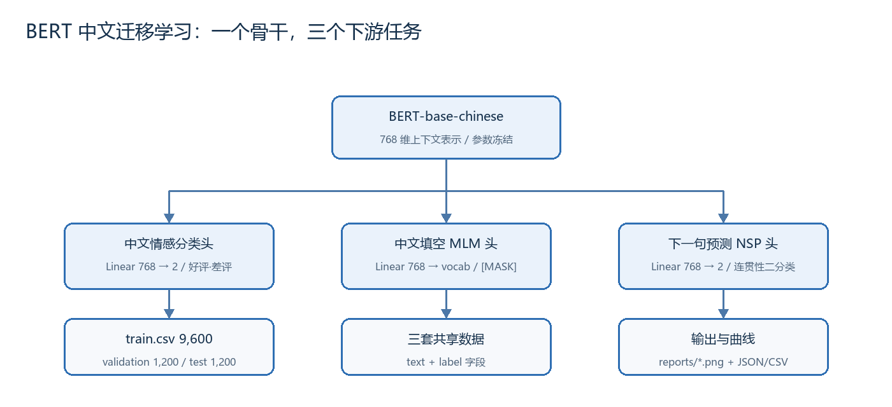
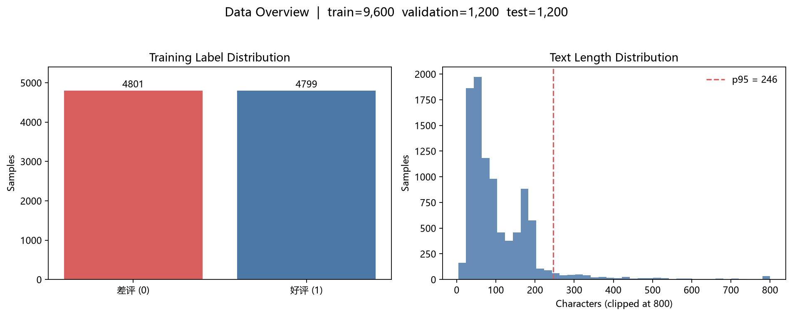
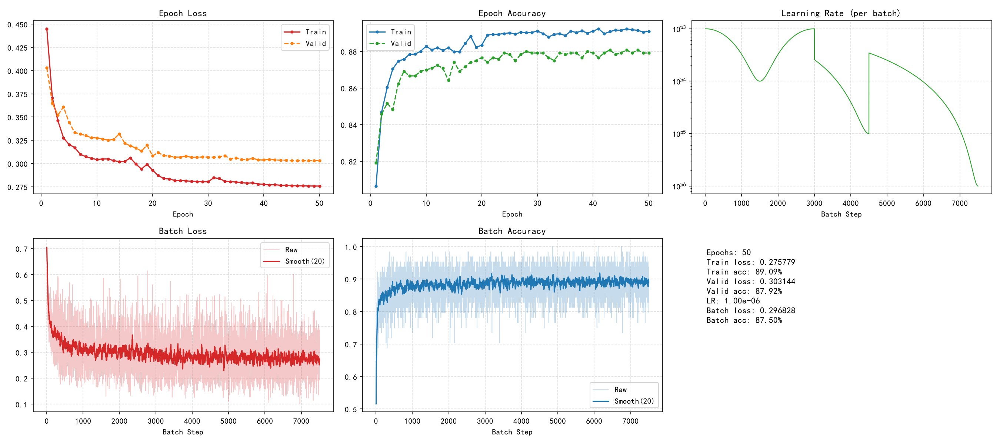
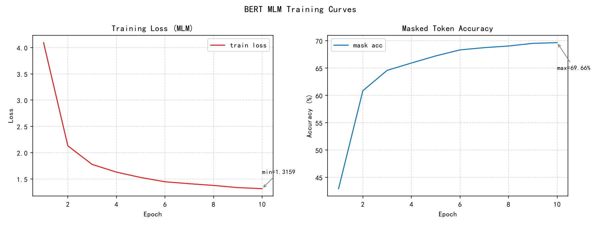
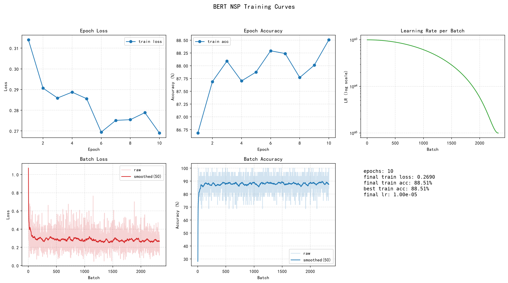

# BERT 中文迁移学习：情感分类、MLM 与 NSP

基于 `bert-base-chinese` 的中文迁移学习实验仓库。骨干网络参数冻结，只训练三个轻量下游头，分别完成中文情感分类、掩码语言建模（MLM）和下一句预测（NSP）。

## 项目概览

| 任务 | 下游头 | 目标 | 数据量 |
|---|---|---|---:|
| 中文情感分类 | Linear 768 → 2 | 区分好评/差评 | 9,600 训练 / 1,200 验证 / 1,200 测试 |
| 中文填空 MLM | Linear 768 → vocab | 预测被随机遮挡的 token | 共享情感评论语料 |
| 下一句预测 NSP | Linear 768 → 2 | 判断两段文本是否来自同一句子 | 共享情感评论语料 |

项目不是“调用一次 pipeline”的演示，而是保留了完整训练循环、验证、断点恢复、随机种子、训练曲线和可复现的 CSV 数据。

## 任务结构

三个任务共享同一个冻结的 BERT 骨干：

- 情感分类使用 `pooler_output`，接一个 768 → 2 的分类头。
- MLM 使用 `last_hidden_state`，接一个 768 → 词表大小的分类头。
- NSP 使用 `pooler_output`，接一个 768 → 2 的句对分类头。

## 数据概览

数据文件位于 `data/`：

| 文件 | 样本数 | 用途 |
|---|---:|---|
| `train.csv` | 9,600 | 训练 |
| `validation.csv` | 1,200 | 验证与最佳模型选择 |
| `test.csv` | 1,200 | 最终评估 |

训练集类别基本均衡：

- 标签 0：4,801 条
- 标签 1：4,799 条

文本长度：

- 平均 108.63 字符
- 中位数 76 字符
- 95 分位 246 字符
- 最大 1,992 字符

CSV 字段为 `text,label`。代码在训练时将文本截断到固定长度：分类 256、MLM 128、NSP 50。

## 结果

### 中文情感分类

训练配置：

- 50 个 epoch
- 冻结 BERT，只优化 768 → 2 分类头
- AdamW + CosineAnnealingLR
- 断点自动恢复，验证集最佳模型单独保存

结果：

| 指标 | 数值 |
|---|---:|
| 最佳验证准确率 | **88.08%**（第 43 epoch） |
| 最终训练准确率 | 89.09% |
| 最终验证准确率 | 87.92% |
| 最终验证 loss | 0.303144 |

原始训练历史保存在 `reports/classification_history.json`，包含每个 epoch 的 loss、accuracy、验证指标，以及 batch 级曲线数据。

### 中文填空 MLM

训练配置：

- 10 个 epoch
- 每个 batch 随机遮挡 15% 的非特殊 token
- 使用 `CrossEntropyLoss(ignore_index=-100)`
- 只训练 768 → vocab 的 MLM 头

结果：

| 指标 | 数值 |
|---|---:|
| 第 1 epoch mask 准确率 | 42.94% |
| 第 10 epoch mask 准确率 | **69.66%** |
| 第 10 epoch loss | 1.315892 |

`reports/mlm_train_log.csv` 记录了完整的 10 个 epoch 指标。MLM 的测试集评估也是随机遮挡的，因此单次 test 指标存在随机性。

### 下一句预测 NSP

NSP 的句子对来自同一条评论的前后半段：

- 正样本：同一句子的前 22 字符 + 后 22 字符
- 负样本：当前句子前半段 + 随机另一条句子的后半段

结果：

| 指标 | 数值 |
|---|---:|
| 训练 epoch | 10 |
| 最终训练准确率 | **85.51%** |
| 最佳训练准确率 | 88.51% |
| 最终训练 loss | 0.2690 |

NSP 脚本没有独立验证集，训练曲线中的 accuracy 是训练集指标，不能直接当作泛化准确率。

## 目录结构

~~~text
bert-chinese-transfer-learning/
├── data/
│   ├── train.csv
│   ├── validation.csv
│   └── test.csv
├── docs/
│   ├── overview.png
│   └── data_profile.png
├── reports/
│   ├── classification_curve.png
│   ├── classification_history.json
│   ├── mlm_curve.png
│   ├── mlm_train_log.csv
│   └── nsp_curve.png
├── src/
│   ├── __init__.py
│   ├── classification.py
│   ├── mlm.py
│   ├── nsp.py
│   └── plot_training.py
├── .gitignore
├── requirements.txt
└── README.md
~~~

## 环境要求

- Python 3.10+
- PyTorch 2.x
- Transformers 4.x
- 可选 GPU；CPU 也能运行，但训练会明显变慢
- 约 1 GB 磁盘空间用于 BERT 权重和虚拟环境

## 安装

~~~bash
python -m venv .venv

# Windows PowerShell
.venvScriptsactivate

# macOS / Linux
source .venv/bin/activate

pip install -r requirements.txt
~~~

## 准备 BERT 权重

代码默认从 `models/bert-base-chinese` 加载模型，也可以通过 `BERT_MODEL_PATH` 指定已有目录：

~~~bash
huggingface-cli download bert-base-chinese --local-dir models/bert-base-chinese
~~~

如果没有安装 `huggingface-cli`，也可以使用 Python：

~~~python
from huggingface_hub import snapshot_download
snapshot_download("bert-base-chinese", local_dir="models/bert-base-chinese")
~~~

模型权重不会提交到 Git，`models/` 和 `checkpoints/` 已在 `.gitignore` 中排除。

## 训练与评估

从仓库根目录执行，保证 `src` 能作为包被导入：

~~~bash
# 情感分类：训练 + 测试
python -m src.classification

# MLM：当前入口默认执行评估；训练时将文件末尾的 train() 取消注释
python -m src.mlm

# NSP：当前入口默认执行评估；训练时将文件末尾的 train() 取消注释
python -m src.nsp
~~~

如果修改了训练循环，也可以单独用绘图脚本重绘分类曲线：

~~~bash
python -m src.plot_training \
  --history reports/classification_history.json \
  --output reports/classification_curve.png \
  --no-show
~~~

训练产物默认写入：

- `checkpoints/`：模型权重与断点，不提交到 Git
- `reports/`：训练曲线、历史 JSON、MLM 日志

## 实现细节

### 断点恢复

分类任务会把模型、优化器、调度器、当前 epoch、global step、验证集最佳准确率和随机数状态一起保存；训练中断后再次运行会自动恢复。

### 训练曲线

`plot_training.py` 支持从 `training_history.json` 或分类断点读取历史，绘制：

- epoch 训练/验证 loss
- epoch 训练/验证 accuracy
- 每个 batch 的学习率
- batch loss（原始值 + 平滑值）
- batch accuracy（原始值 + 平滑值）
- 最终指标摘要

### 冻结策略

三个下游任务都调用 `bert_model.eval()` 并冻结 BERT 参数，只更新各自的任务头。这样可以显著降低显存需求，也把项目重点放在“迁移学习头”的设计和评估上。

## 可复现性说明

- 分类和 MLM 设置了 `torch.manual_seed(42)`，NSP 也设置了相同的随机种子。
- 数据文件、训练历史、三张结果图和 MLM 日志均已提交，模型权重未提交。
- 当前结果来自课程实验环境；不同 GPU、PyTorch 版本和 HuggingFace 版本可能导致末位差异。
- 仓库没有把训练准确率包装成测试准确率；分类报告验证集指标，MLM 报告 mask token 指标，NSP 明确标注为训练集指标。

## 已知限制

- 只做冻结骨干的轻量迁移，没有做 BERT 全参数微调，因此不能代表 BERT 在中文情感分类上的上限。
- NSP 的负样本由“另一条评论的后半段”构造，句子边界和语义连贯性都比较粗糙。
- MLM 的遮挡位置每个 batch 随机生成，测试指标会随遮挡采样波动。
- 数据来自课程实验的中文酒店评论 CSV；如果用于公开产品，需要重新确认数据授权、脱敏和隐私合规。
- 仓库不包含预训练权重和训练后的 `.bin` 文件，首次运行必须先下载 BERT 或提供本地模型路径。

## 适合展示的点

- 一个 BERT 骨干复用三个不同下游头，任务边界清晰。
- 完整训练循环，不是单次推理脚本。
- 验证集最佳模型、断点恢复、随机种子、训练历史落盘。
- 用真实训练曲线和数据统计说明结果，而不是只放架构图。
- 明确的限制和指标口径，避免把训练准确率误读成泛化指标。

## 数据与合规

本仓库保留课程实验使用的中文酒店评论 CSV，仅用于学习、复现和作品展示。评论数据可能包含用户生成内容，公开使用前应确认数据来源授权、完成脱敏，并遵守所在地隐私与数据处理要求。
